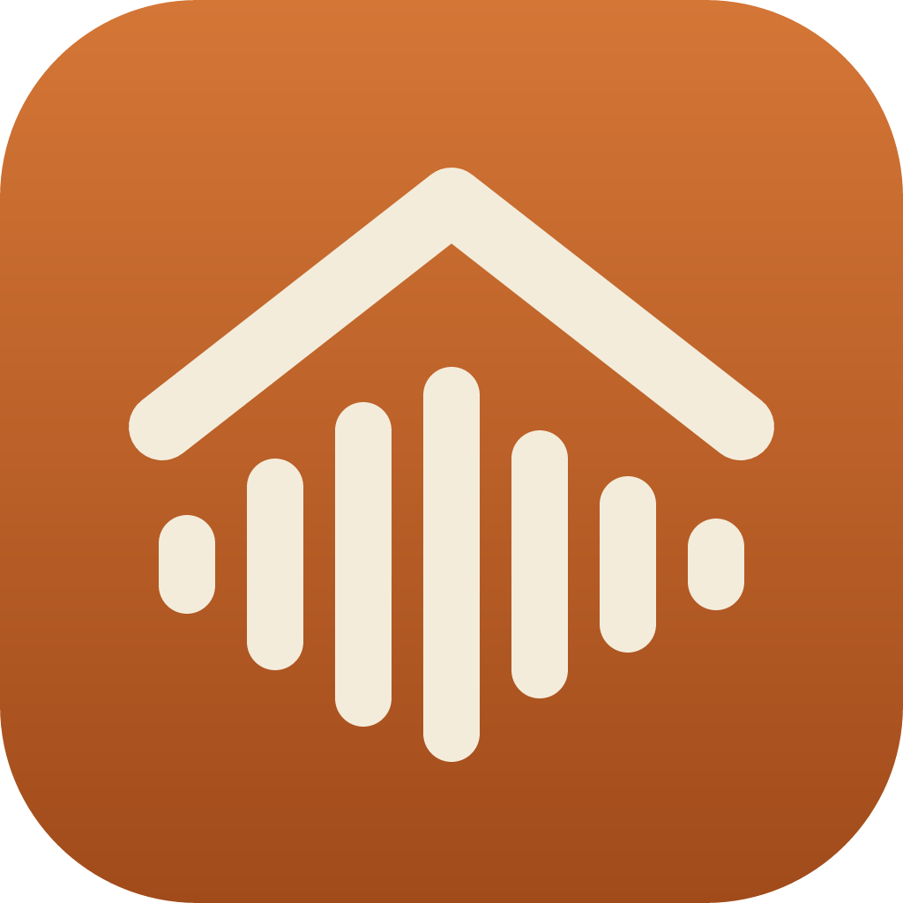
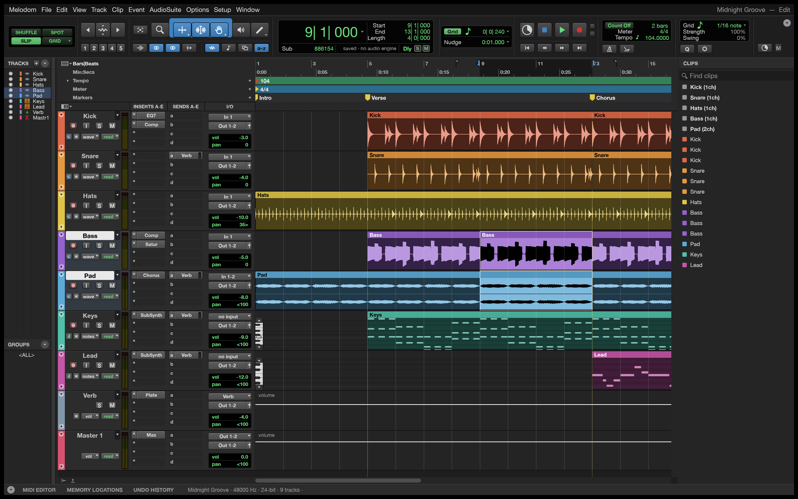
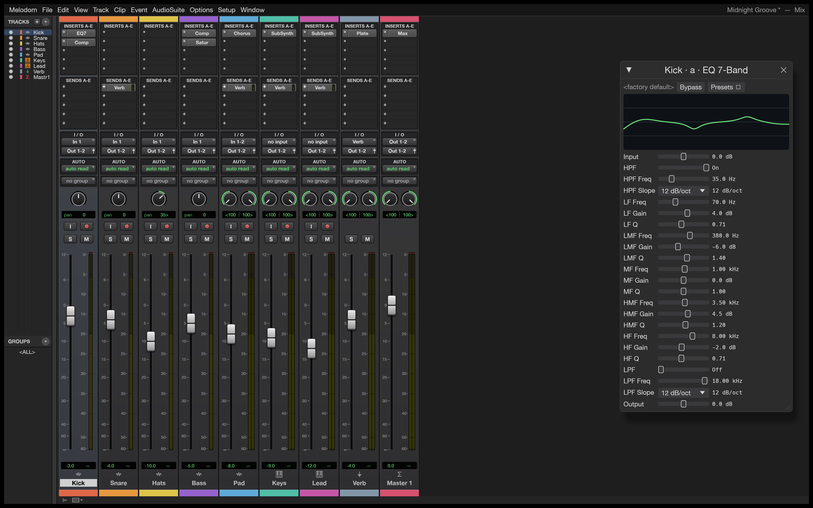
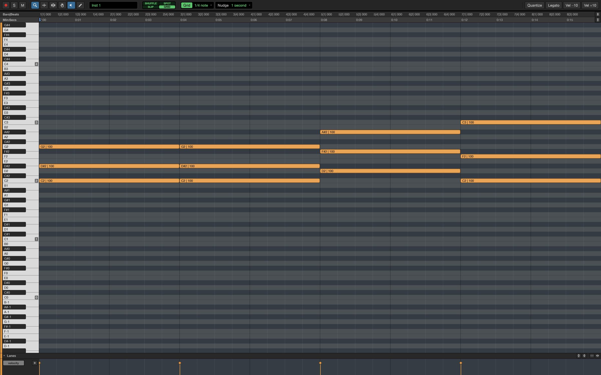
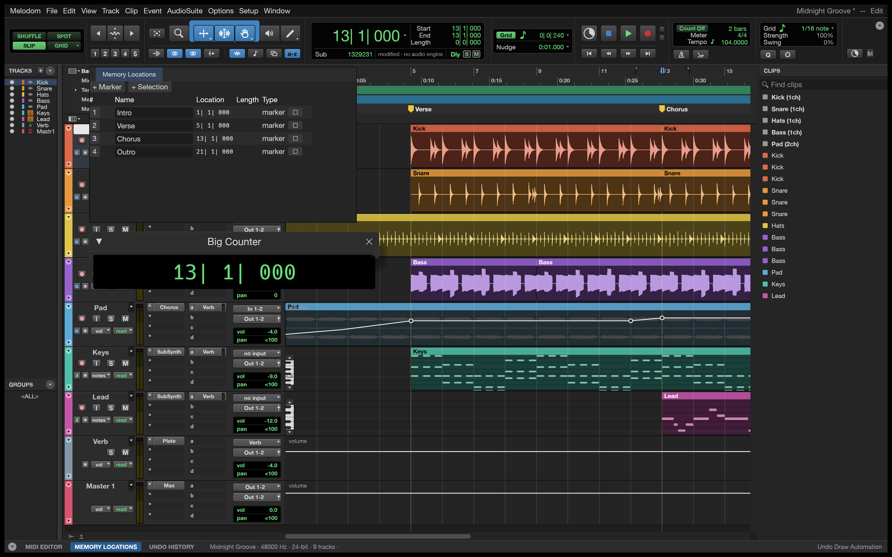
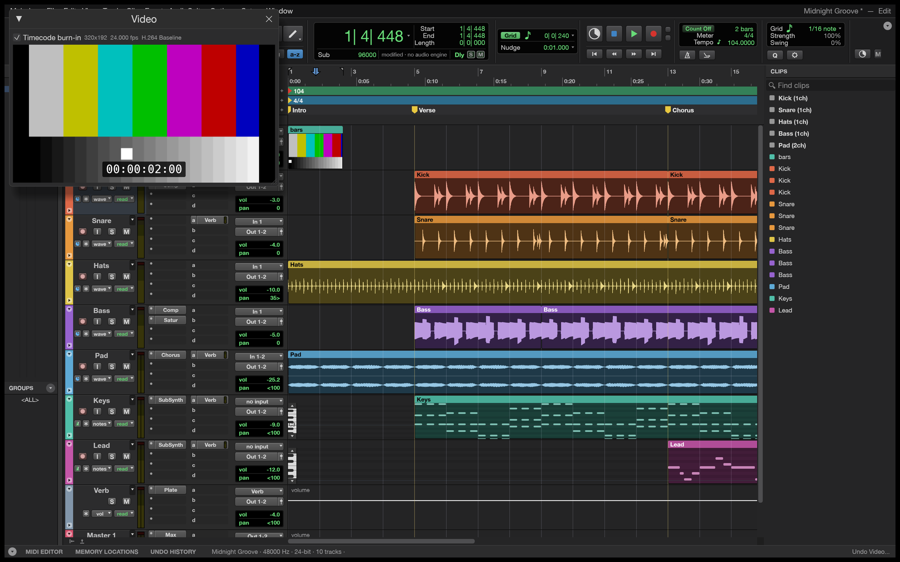
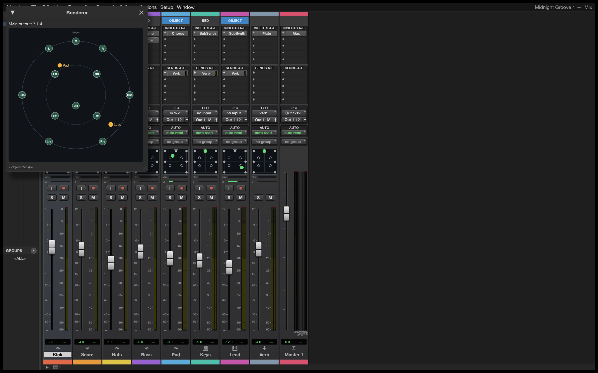
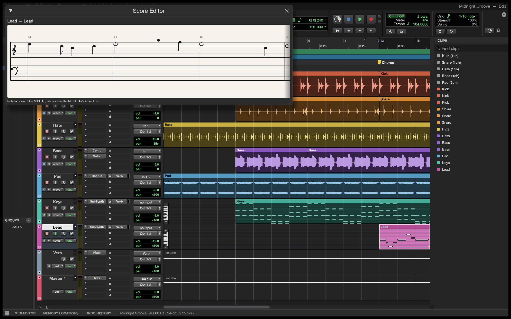
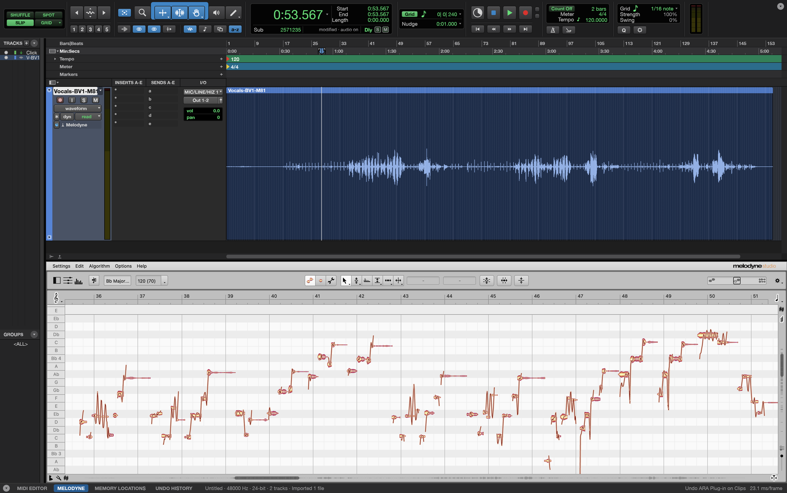

<p align="center">
  
</p>

<h1 align="center">Melodom</h1>

<p align="center">
  <b>A free digital audio workstation that works the way Pro Tools users expect.</b><br>
  Record, edit, mix and bounce on macOS. Written in Rust.
</p>

<p align="center">
  
  
  
</p>

<p align="center">
  
  <br>
  <sub>The Edit window with the built-in demo song. Every sound in it is synthesised by Melodom itself.</sub>
</p>

## What it is

Melodom is a digital audio workstation for recording, editing and mixing audio and MIDI. It follows
the Pro Tools workflow, from the Edit and Mix windows to the edit modes, tools, menus and
shortcuts, so if you know Pro Tools, you already know your way around.

- **Edit** audio and MIDI with playlists, comping, fades, clip gain and Beat Detective, with undo
  and an Undo History.
- **Mix** with inserts, sends, busses, automation and delay compensation, using the built-in
  plug-ins or your own CLAP, VST3 and Audio Units.
- **Tune** vocals with Melodyne or another ARA plug-in, docked at the bottom of the Edit window as
  in Pro Tools.
- **Record** with punch-in, loop recording and input monitoring. Autosave brings your work back
  after a crash.
- **Go further** with video, surround and immersive mixing, and notation.
- **Script it:** every action is a command you can run from the command line or hand to an AI
  agent.

<table>
  <tr>
    <td width="50%"></td>
    <td width="50%"></td>
  </tr>
  <tr>
    <td><b>Mix.</b> Inserts, sends, busses and meters, with the built-in plug-ins or your own.</td>
    <td><b>MIDI.</b> A piano roll with velocities, quantize and recording from your controller.</td>
  </tr>
  <tr>
    <td width="50%"></td>
    <td width="50%"></td>
  </tr>
  <tr>
    <td><b>Automation.</b> Draw it, or write it live from the faders; Memory Locations and the Big Counter alongside.</td>
    <td><b>Video.</b> A picture track with thumbnails and a Video window with timecode burn-in.</td>
  </tr>
  <tr>
    <td width="50%"></td>
    <td width="50%"></td>
  </tr>
  <tr>
    <td><b>Surround.</b> Formats up to 9.1.6 and Ambisonics, and a panner with divergence and height.</td>
    <td><b>Notation.</b> A Score Editor, printable scores and MusicXML export.</td>
  </tr>
</table>

## Melodyne and other ARA plug-ins

<p align="center">
  
  <br>
  <sub>Melodyne on a vocal track, in its tab at the bottom of the Edit window.</sub>
</p>

Melodom hosts ARA 2 plug-ins such as Melodyne, in VST3, Audio Unit or CLAP format. Put one on clips
from their right-click menu, or on a whole track from its Elastic Audio/ARA selector: the clips play
through it, and Bounce Mix hears its edits. Its window docks in a tab of its own at the bottom of
the Edit window and follows the selection, or opens on its own from **Window › ARA Plugins**. The
edits are saved with the session, in an `ARA Data` folder beside it.

## Getting started

Melodom runs on macOS 11 or later for now; Windows and Linux builds will follow once they've been
tested. Download the DMG from [Releases](https://github.com/grovebit/melodom/releases/latest), open
it and drag Melodom to Applications. The app isn't notarized yet, so macOS stops it the first time:
click **Open Anyway** in **System Settings › Privacy & Security**, or on macOS 14 and earlier,
right-click Melodom and choose **Open**. Then, in the Dashboard, tick **Start from the demo
session** and click **Create**.

Press <kbd>Space</kbd> to play, <kbd>⌘</kbd><kbd>=</kbd> to switch between Edit and Mix, and open
**Setup › Keyboard Shortcuts** for the rest.

## Scripting and AI agents

Everything you can click is also a command:

```sh
# Turn the demo's kick down, add an EQ to the bass and bounce the mix, without opening the app.
melodom-cli run --demo \
  --cmd 'mix.volume={"track":"Kick","db":-6}' \
  --cmd 'mix.insert={"track":"Bass","plugin":"eq_7band"}' \
  --bounce mix.wav

# Give Claude a DAW.
claude mcp add melodom -- melodom-cli mcp --demo
```

`melodom-cli` comes in the release's CLI zip.

## Status

Melodom is **pre-alpha**. Recording, editing, mixing and bouncing work end to end, but it can't
exchange sessions with Pro Tools or picture editors yet (AAF export, OMF), and it isn't ready for
paid work. Bug reports and wishes are welcome in the issues.

## License and credits

Melodom is free to download and use. Its source code isn't public at the moment. Copyright (c) 2026
grovebit and the Melodom contributors.

Melodom started as a fork of [SoundCraft](https://github.com/storytold/soundcraft) in October 2026,
and most of its code has been written since. The code that came from SoundCraft keeps SoundCraft's
copyright notice, (c) 2026 ArtCraft Team and the SoundCraft contributors, and its MIT OR Apache-2.0
license texts, which come with the app in `Melodom.app/Contents/Resources/Licenses`.

The app icon is original, every icon in the interface is drawn in code, and the demo song is
synthesised by the app itself. Bundled fonts and other assets keep their own licenses, listed in
the app's `ATTRIBUTION.md`; the Melodyne screenshot shows Celemony's own window. The app in the
release DMG includes the [LAME](https://lame.sourceforge.io/) MP3 encoder as a separate program
under its own license, LGPL-2.0-or-later.

<sub>Avid and Pro Tools are trademarks or registered trademarks of Avid Technology, Inc. in the United States and/or other countries. Melodyne and ARA Audio Random Access are trademarks or registered trademarks of Celemony Software GmbH. VST is a trademark of Steinberg Media Technologies GmbH, registered in Europe and other countries. Other names are trademarks of their owners. Melodom is an independent project and is not affiliated with, sponsored by or endorsed by Avid Technology, Inc., Celemony Software GmbH or any other company named here; these names are used only to describe the workflows and plug-ins it is compatible with.</sub>
